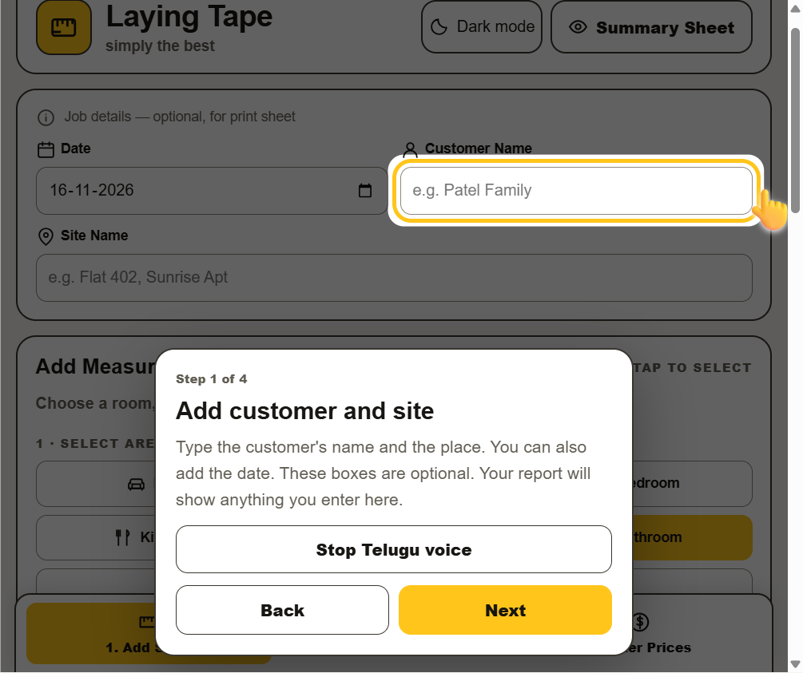
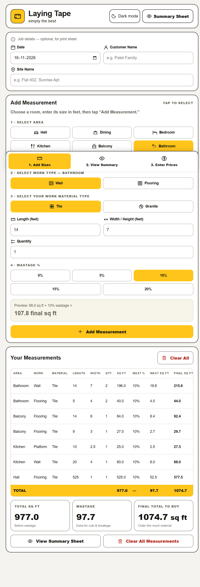
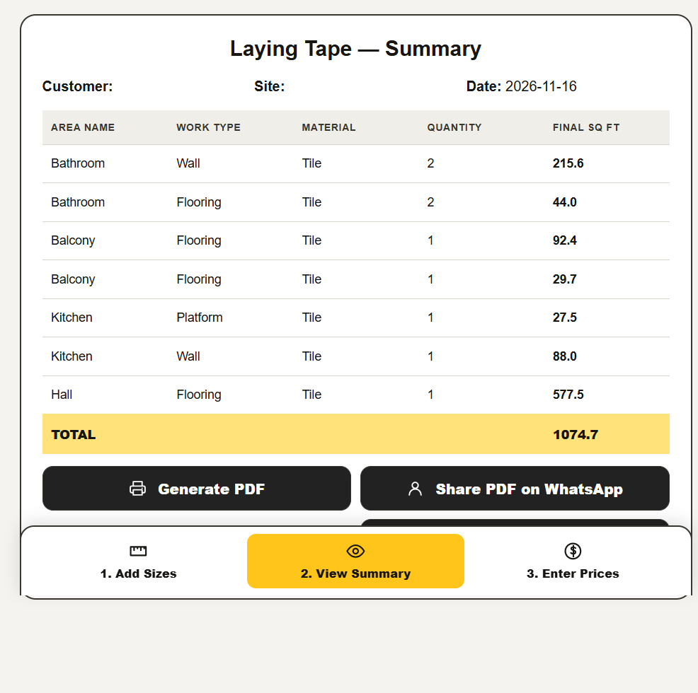
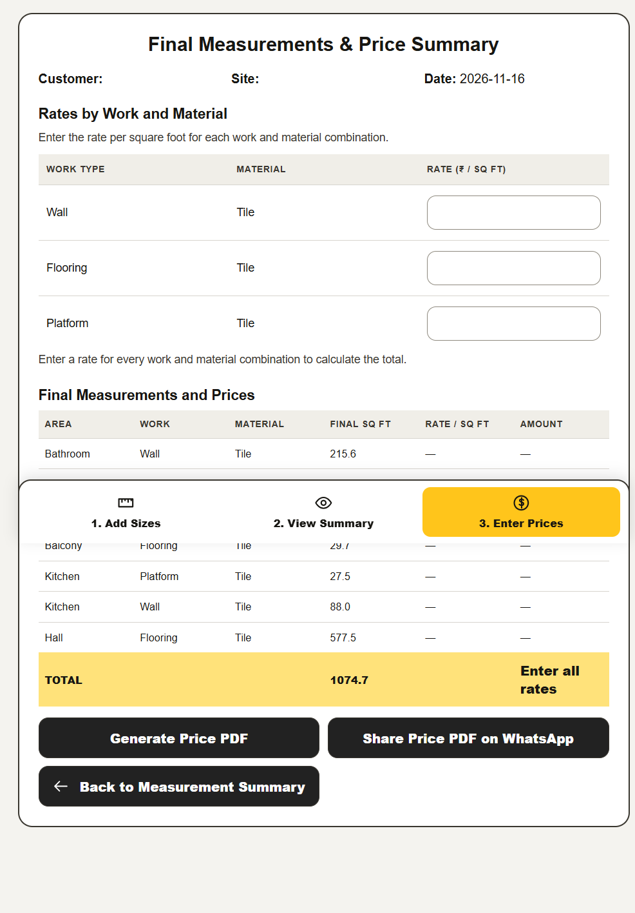

# Laying Tape

A mobile-friendly Progressive Web App (PWA) for measuring rooms, estimating material quantities with wastage, and preparing measurement and price summaries.

## Features

- Record areas, work types, materials, dimensions, and quantities.
- Calculate square footage and add a wastage allowance.
- Add optional customer, site, and date details to print sheets.
- Create and share measurement and price summary PDFs.
- Switch between light and dark themes.
- Install the app for standalone use; the service worker caches app files for offline use.

## Run and install

Serve this folder from `localhost` or a site using HTTPS so the service worker and PWA installation can work. For a quick local server with Python:

```powershell
python -m http.server 8000
```

Open [http://localhost:8000](http://localhost:8000) in a supported browser. Use the browser's install option (or the app's **Install App** button when available) to add Laying Tape to your device.

The first time you open the installed app, a hand points to the buttons while four short help pages explain what to do. On supported devices, your device reads each page aloud in Telugu. Tap **Play Telugu voice** to hear it again. Tap **Next** to continue. You must finish the tour before using the app. It will not show again. If Telugu voice is not available, add a Telugu voice in your device's text-to-speech settings.

## Screenshots

### First-launch app tour



### Measurements



### Measurement summary



### Price summary



## Notes

- PDF generation uses jsPDF from a CDN. PDF features need an internet connection until the library is cached for offline use.
- Measurement edits are held in memory. Reloading restores the built-in sample measurements and discards changes made during that session.
